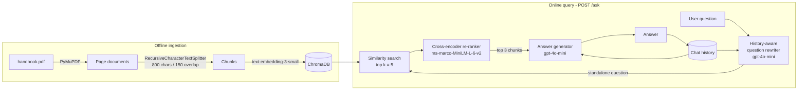

# Christ Handbook Bot

A conversational **Retrieval-Augmented Generation (RAG)** assistant that answers student questions using the Christ University student handbook. Instead of searching a 78 MB PDF by hand, students ask in plain English, such as *"What is the minimum attendance requirement?"*, and get a short answer taken from the handbook text.

The system handles follow-up questions. It rewrites each one into a standalone query using the conversation so far. It retrieves candidate passages from a vector store and re-ranks them with a cross-encoder. The LLM is told to answer only from those passages, which keeps hallucinations down.


---

## Table of Contents

- [Features](#features)
- [Architecture](#architecture)
- [Tech Stack](#tech-stack)
- [Project Structure](#project-structure)
- [Getting Started](#getting-started)
- [Usage](#usage)
- [Configuration](#configuration)
- [How It Works](#how-it-works)
- [Troubleshooting](#troubleshooting)
- [Limitations & Roadmap](#limitations--roadmap)
- [License](#license)
- [Author](#author)

---

## Features

- **Grounded answers:** the LLM may only use the retrieved handbook text. If the answer isn't there, it says *"I could not find that information in the handbook."*
- **Conversational memory:** follow-ups like *"What about for PG students?"* are rewritten into standalone questions before retrieval.
- **Two-stage retrieval:** a fast dense vector search (top 5), then cross-encoder re-ranking for precision (top 3 go into the prompt).
- **Page-aware ingestion:** every chunk keeps its source page number as metadata.
- **REST API:** a FastAPI service with interactive Swagger docs at `/docs`.
- **Configurable:** the model, embedding model, vector store location and source PDF are all set through environment variables.

---

## Architecture



---

## Tech Stack

| Layer | Technology | Purpose |
|---|---|---|
| PDF parsing | [PyMuPDF](https://pymupdf.readthedocs.io/) | Fast, page-level text extraction |
| Chunking | LangChain `RecursiveCharacterTextSplitter` | Splits text on structure (paragraph, then line, then sentence) |
| Embeddings | OpenAI `text-embedding-3-small` | Dense vector representations |
| Vector store | [ChromaDB](https://www.trychroma.com/) via `langchain-chroma` | Local, persistent similarity search |
| Re-ranking | `cross-encoder/ms-marco-MiniLM-L-6-v2` (Sentence-Transformers) | Scores query–passage relevance for precision |
| LLM | OpenAI `gpt-4o-mini` | Rewrites questions and generates answers |
| API | FastAPI + Uvicorn | HTTP interface with auto-generated OpenAPI docs |
| Config | python-dotenv | Loads settings from the environment |

---

## Project Structure

```
Christ-Handbook-bot/
├── app/
│   ├── api/
│   │   └── main.py              # FastAPI app: /ask and /health endpoints
│   ├── ingestion/
│   │   ├── loader.py            # PDF -> per-page LangChain Documents
│   │   ├── chunker.py           # Recursive text splitting
│   │   ├── embedder.py          # Embeds chunks and writes them to Chroma
│   │   └── ingest.py            # Ingestion entry point
│   ├── retrieval/
│   │   ├── history_aware.py     # Rewrites follow-ups into standalone questions
│   │   ├── retriever.py         # Chroma similarity retriever
│   │   └── reranker.py          # Cross-encoder re-ranking
│   ├── generation/
│   │   ├── prompts.py           # Grounded RAG prompt template
│   │   └── generator.py         # Answer generation
│   └── db/                      # Persisted vector store (generated, git-ignored)
├── data/
│   └── README.md                # Where to put handbook.pdf (PDF is git-ignored)
├── .env.example                 # Environment variable template
├── requirements.txt
└── README.md
```

---

## Getting Started

### Prerequisites

- **Python 3.10+**
- An **OpenAI API key** ([get one here](https://platform.openai.com/api-keys))
- **Git**
- About **2 GB of free disk space** for PyTorch (pulled in by `sentence-transformers`) and the re-ranker model

### 1. Clone the repository

```bash
git clone https://github.com/vathira-netizen/Christ-Handbook-bot.git
cd Christ-Handbook-bot
```

### 2. Create and activate a virtual environment

**Windows (PowerShell)**
```powershell
python -m venv venv
.\venv\Scripts\Activate.ps1
```

**macOS / Linux**
```bash
python3 -m venv venv
source venv/bin/activate
```

### 3. Install dependencies

```bash
pip install --upgrade pip
pip install -r requirements.txt
```

> **Tip:** On a machine without a GPU, you can install the much smaller CPU-only PyTorch build first:
> `pip install torch --index-url https://download.pytorch.org/whl/cpu`

### 4. Configure environment variables

Copy the template and add your OpenAI API key:

**Windows (PowerShell)**
```powershell
Copy-Item .env.example .env
```

**macOS / Linux**
```bash
cp .env.example .env
```

Then edit `.env`:

```env
OPENAI_API_KEY=sk-...
MODEL_NAME=gpt-4o-mini
EMBEDDING_MODEL=text-embedding-3-small
CHROMA_DB_DIR=app/db/chroma
PDF_PATH=data/handbook.pdf
```

> Never commit your `.env` file. It is already listed in `.gitignore`.

### 5. Add the handbook PDF

The PDF is not included in the repository because of its size. Download the student handbook and save it as:

```
data/handbook.pdf
```

### 6. Build the vector store (one-time)

From the project root, run:

```bash
python -m app.ingestion.ingest
```

This parses the PDF, splits it into chunks, embeds them with OpenAI, and saves the index to `app/db/chroma`. Re-run it whenever the handbook changes. Delete `app/db/chroma` first so you don't get duplicate chunks.

### 7. Start the API server

```bash
uvicorn app.api.main:app --reload
```

The API is now running at **http://127.0.0.1:8000**.

> The first request downloads the cross-encoder re-ranker (~90 MB) from Hugging Face, so it will be slower than later ones.

---

## Usage

### Interactive docs

Open **http://127.0.0.1:8000/docs** to try the API from the Swagger UI.

### Endpoints

| Method | Path | Description |
|---|---|---|
| `GET` | `/health` | Liveness check |
| `POST` | `/ask` | Ask a question about the handbook |

### Example request

**curl (macOS / Linux / Git Bash)**
```bash
curl -X POST http://127.0.0.1:8000/ask \
  -H "Content-Type: application/json" \
  -d '{"question": "What is the minimum attendance required to write exams?"}'
```

**PowerShell**
```powershell
Invoke-RestMethod -Uri http://127.0.0.1:8000/ask -Method Post `
  -ContentType "application/json" `
  -Body '{"question": "What is the minimum attendance required to write exams?"}'
```

**Python**
```python
import requests

resp = requests.post(
    "http://127.0.0.1:8000/ask",
    json={"question": "What is the minimum attendance required to write exams?"},
)
print(resp.json()["answer"])
```

### Example response

```json
{
  "question": "What about for PG students?",
  "standalone_question": "What is the minimum attendance requirement for postgraduate students to be eligible for exams?",
  "answer": "..."
}
```

`standalone_question` shows how the system rewrote your question using the chat history. It is useful for debugging retrieval.

---

## Configuration

| Variable | Default | Description |
|---|---|---|
| `OPENAI_API_KEY` | (required) | OpenAI API key used for chat and embeddings |
| `MODEL_NAME` | `gpt-4o-mini` | Chat model for question rewriting and answer generation |
| `EMBEDDING_MODEL` | `text-embedding-3-small` | Embedding model (must match between ingestion and querying) |
| `CHROMA_DB_DIR` | `app/db/chroma` | Where the Chroma index is stored |
| `PDF_PATH` | `data/handbook.pdf` | Source PDF used during ingestion |

Pipeline settings in the code:

| Setting | Value | Location |
|---|---|---|
| Chunk size / overlap | 800 / 150 characters | `app/ingestion/chunker.py` |
| Retrieval candidates (`k`) | 5 | `app/retrieval/retriever.py` |
| Chunks passed to the LLM | 3 | `app/api/main.py` |
| Re-ranker model | `cross-encoder/ms-marco-MiniLM-L-6-v2` | `app/retrieval/reranker.py` |
| LLM temperature | 0 | `app/generation/generator.py` |

---

## How It Works

1. **Load:** PyMuPDF extracts text page by page. Each page becomes a LangChain `Document` with its `page` number as metadata.
2. **Chunk:** `RecursiveCharacterTextSplitter` splits pages into ~800-character chunks with a 150-character overlap. It prefers paragraph, then line, then sentence boundaries, so related content stays together.
3. **Embed and index:** chunks are embedded with `text-embedding-3-small` and stored in a persistent Chroma collection.
4. **Rewrite the question:** for each query, the chat history and the new question go to the LLM, which returns a self-contained question. Without this step, a follow-up like *"and the fee for that?"* would retrieve the wrong passages.
5. **Retrieve:** the five nearest chunks are fetched by vector similarity (a bi-encoder, so recall is high but ranking is coarse).
6. **Re-rank:** a cross-encoder reads each (question, chunk) pair together and scores relevance, which is much more precise than comparing embeddings. The top three chunks become the context.
7. **Generate:** a strict prompt tells the LLM to answer only from the context and to fall back to a fixed "not found" message.
8. **Remember:** the question and answer are added to the chat history for the next turn.

---

## Troubleshooting

| Problem | Fix |
|---|---|
| `ModuleNotFoundError: No module named 'app'` | Run commands from the project root, and use `python -m app.ingestion.ingest` rather than `python app/ingestion/ingest.py`. |
| `FileNotFoundError: Handbook PDF not found` | Put the PDF at `data/handbook.pdf` or set `PDF_PATH` in `.env`. |
| `openai.AuthenticationError` | Check that `OPENAI_API_KEY` in `.env` is valid and the file is in the project root. |
| Answers are always "I could not find that information…" | The vector store is probably empty. Re-run ingestion and check that `CHROMA_DB_DIR` is the same for ingestion and the API. |
| Duplicate or repeated context | Ingestion was run more than once. Delete `app/db/chroma` and ingest again. |
| PowerShell blocks `Activate.ps1` | Run `Set-ExecutionPolicy -Scope CurrentUser RemoteSigned` once. |

---

## Limitations & Roadmap

**Current limitations**
- Chat history is held in one in-memory list, so it is **shared by all clients** and cleared when the server restarts.
- History grows without limit, so very long conversations will eventually fill the context window.
- Answers don't cite page numbers yet, even though page metadata is stored.
- Text extraction only: tables and scanned images in the PDF are not interpreted.

**Planned improvements**
- [ ] Per-session chat history (session IDs, plus Redis or a database)
- [ ] Return source page citations with every answer
- [ ] Hybrid retrieval (BM25 + dense vectors)
- [ ] Streaming responses
- [ ] Web chat frontend (Streamlit or React)
- [ ] Evaluation harness (e.g. RAGAS) to measure retrieval and answer quality
- [ ] Docker image for one-command deployment

---

## License

This project is licensed under the [MIT License](LICENSE).

> The MIT License covers the source code in this repository only. The Christ University student handbook is not distributed here and remains the property of its owners.

---

## Author

**Athira Venugopalan** · [GitHub @vathira-netizen](https://github.com/vathira-netizen)
